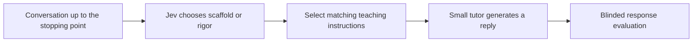

# TutorMoments: Choosing When to Help and When to Challenge

This project asks a practical question about AI math tutoring: **does deciding how to teach before generating a reply improve a small tutor?** Jev reads the conversation, chooses scaffolding or rigor, and selects detailed instructions for the tutor. We use real tutoring conversations from TutorMoments and evaluate the actual generated replies, alongside our earlier decision-only experiment.

## Course paper and review materials

The completed EDUC 6181 course draft combines the qualitative study with the final technical experiment. It is four pages of main text plus one reference page, compiled in Overleaf with XeLaTeX and Biber.

- [Read the paper](paper/course-draft/Conference%20Paper%20Draft.pdf) and [edit the LaTeX source](paper/course-draft/main.tex).
- [Shared submission folder](https://drive.google.com/drive/folders/1BjS3toqoV5py_ZhA1HjCcs162TQ6f7-t) and [Start Here guide](https://docs.google.com/document/d/1wPtkFfFr7Q7KhAdrnEujns3YAVlKszYPpqlgBQDT2dg/edit).
- [Qualitative coding workbook](paper/qualitative-study/Qualitative%20Coding%20and%20Results.xlsx), [coding manual](paper/qualitative-study/Coding%20Manual.md), and [complete source-linked records](paper/qualitative-study/All%2038%20Cases%20-%20Full%20Context%20and%20Coding.json).
- [Project Zotero library](https://www.zotero.org/groups/6740618) and [canonical bibliography](paper/course-draft/references.bib).

The qualitative records cover 38 matched moments and 114 response blocks. Both AI-assisted coding passes, the original 40-case selection, two exclusions, and the full 520-case comparison-eligibility ledger are preserved. No independent human validation is claimed. The public Drive folder provides review copies without requiring access to this private repository. Nothing has been submitted to Canvas by this workflow.

## Latest: complete 520-moment first-reply experiment, 11 November 2026

The final course experiment generated **1,560 Qwen3-32B replies**: detailed self-choice, forced scaffolding, and forced rigor for every moment. Archived Jev and OpenAI Decisions choices selected between the two forced-policy replies. Gemini 2.5 Flash rated all three anonymous replies per case; Claude Sonnet 4.6 rated a fixed 32-case audit. All 520 cases completed, with no truncated replies. New accounted cost was **$3.0029**, including evaluator calls and conservative interrupted-call reservations.

| Policy | All 520 moments | Strict matched math frame, 346 |
|---|---:|---:|
| Detailed self-choice | 357 (68.7%) | 249 (72.0%) |
| Jev-directed | 379 (72.9%) | 252 (72.8%) |
| Decisions-directed | 382 (73.5%) | 260 (75.1%) |
| Always scaffold | 294 (56.5%) | 207 (59.8%) |
| Always rigor | 385 (74.0%) | 263 (76.0%) |
| Assigned-label diagnostic | 438 (84.2%) | 299 (86.4%) |

**Neither router beat the fixed rigor policy.** Jev improved on self-choice by 4.2 percentage points in the full preview (95% student-cluster interval -1.0 to 9.2), but only 0.9 points in the matched math frame (-5.3 to 6.5). Routing increased rigor passes while sacrificing some scaffolding passes. Matching the source category did not guarantee a good reply: even correct routes could return to an obsolete problem or give inappropriate help. The matched math frame has additional eligibility requirements for conversational cuts, duplicate cases and usable replies across 15 original response conditions; it is not simply all mathematical moments.

Evaluator sensitivity remains material. On the same 32 audit cases, Gemini rated self-choice/Jev at 20/19 passes, whereas Claude rated them at 16/22. Pass/fail agreement across 96 replies was 78.1% (kappa .551). This is not human validation. These are exploratory internal first-reply scores under our rubric, not the publisher's multi-turn leaderboard or a held-out generalization test. Archived routing and concurrent generation also do not establish a deployment latency gain.

Start with the [experiment guide](experiments/final-course-pipeline/README.md), [complete results](experiments/final-course-pipeline/RESULTS.md), [all actual replies and ratings](experiments/final-course-pipeline/replies-and-ratings.csv), [all seven paired policy results](experiments/final-course-pipeline/case-results.csv), and [evaluator audit](experiments/final-course-pipeline/Evidence%20and%20Evaluator%20Audit.md). Frozen prompts, exact API traces, source/input checks, interrupted attempts and offline reproduction code are retained. The prior pilots and negative prompt revisions below remain separate.

## Earlier: fresh Astra agents and a complete decision-error casebook

Twenty fresh Astra subagents, run sequentially without inherited conversation or reference answers, scored **14/20 (70%)** using exactly the earlier publisher-adapted API input text. The same-input API test also scored 14/20; two predictions changed, one in each direction. This is a small diagnostic in a different system/tool environment, not an independent held-out benchmark or a reproduction of the website metric. No new paid API calls were made.

The [error casebook](experiments/decision-error-review/README.md) covers **342 distinct disagreements across the archived full-520 runs**, plus **one additional case from the Astra pilot**, with full conversation prefixes, reference labels, model predictions and teacher comments. The latest three revised models all missed **57** cases. Three identical-context pairs have opposite reference labels; the original labels remain unchanged.

- [Fresh-agent method and results](experiments/astra-blind-subagents/README.md)
- [Google Doc: Decision Errors for Review](https://docs.google.com/document/d/1HXVbQNR_8GgFogpoedYhRXvw04WB3XH5WcLK6K5ZOZY/edit)
- [All 520 model decisions](experiments/decision-error-review/All%20520%20decisions%20for%20review.csv)
- [Full-context browser viewer](experiments/decision-error-review/TutorMoments%20Decision%20Error%20Review.html) (download and open locally)

The website's approximately **92.7%** evaluates a short tutoring exchange and allows `both` scaffolding and rigor when no over-scaffolding is detected. Our exclusive next-category task is different. See the [publisher scoring code](https://github.com/allenai/tutormoments/blob/main/src/tutormoments/report.py).

## Earlier: requested decision-only test with the publisher prompt

We retained the publisher's evaluation-aware teaching guidance, replaced the message-writing instruction with a one-word **scaffolding or rigor** request, and supplied the full pre-cut conversation. Astra used the official OpenAI API with high reasoning. No tutoring response, simulated student or judge was generated in this experiment.

| Decision prompt | Correct on the same 20 moments | Scaffolding /10 | Rigor /10 |
|---|---:|---:|---:|
| Publisher prompt adapted for one decision | **14/20 (70%)** | 6 | 8 |
| Previous revised prompt | 13/20 (65%) | 5 | 8 |

One error was corrected with no regressions. New token cost was **$1.2145**; every output was valid and complete. This small exploratory result is not evidence of a general five-point accuracy gain. The website's tutoring-replay percentage is a different outcome. [Report and exact prompt](experiments/astra-publisher-prompt-decisions/README.md), [all 20 decisions](experiments/astra-publisher-prompt-decisions/All%2020%20decisions.csv).

## Earlier: four tutoring replays, outside the clarified decision-only request

Astra ran through the **official OpenAI API** with the publisher's unchanged evaluation-aware tutoring instructions. The original Claude Opus 4.6 student and judge were retained through OpenRouter, pinned to Anthropic. **Three of four replays passed** the publisher's scoring rule: scaffolding 2/2, rigor 1/2. One rigor replay contained both action types but failed because the judge found over-scaffolding.

New token usage cost **$1.0515**, or **$1.1926** including the reused first reply. All four planned cases completed, with no API failures or truncated outputs. New calls used an explicitly disclosed 8,192-token output ceiling instead of the original 128,000; the largest output was 1,054 tokens. This four-case implementation check is not a benchmark accuracy estimate or an exact replication of every generation setting. No top-up was needed, and no larger run was launched.

[Full report](experiments/astra-publisher-small/README.md), [readable replays and scorer judgments](experiments/astra-publisher-small/Readable%20replays.md), [four-case results](experiments/astra-publisher-small/Four%20replay%20results.csv). The original 20-case setup below remains preserved and was not resumed.

## Earlier: original 128,000-token setup, not resumed

The previous 65% result used our binary-decision prompt, not the publisher's original tutoring prompt. It cannot be compared directly with the website's approximately 92.7% tutoring-replay score. A [20-case original-protocol replication](experiments/astra-publisher-replay/README.md) now preserves their tutor prompt, five-speaking-call exchange, Claude Opus 4.6 student and scorer, and original scoring rule. The first Astra reply completed; OpenRouter then rejected the student request because the balance could not cover the original 128,000-token output ceiling. **No complete replay score is available yet.** Completed-call token cost is $0.1411. That exact-ceiling setup was not resumed; the completed four-case budget adaptation is linked above.

## Earlier: small Astra decision pilot and routing assessment

A frozen **20-moment decision-only pilot** compared GPT-6 Astra with high reasoning against the same latest prompt and saved cheap-model predictions. The sample contains ten scaffolding and ten rigor moments from different students, selected without using prediction correctness.

| Method | Correct /20 | Token cost for these 20 | Median complete request |
|---|---:|---:|---:|
| Astra, high reasoning | 13 | $1.3880 | 4.61s |
| OpenAI Decisions, Luna | 13 | $0.0118 | 0.35s |
| Jev 1.14.0 | 12 | $0.0057 | 0.26s |
| Luna, one-word answer | 12 | $0.0119 | 1.01s |

This pilot **does not establish an Astra accuracy advantage or equivalence between models**. It does show a large observed cost difference. Cheap-model timings are historical; Astra's are from the new run. Its 13/20 score measures a forced decision, not the website's multi-turn tutoring-replay metric. No outputs were invalid or truncated. New spending was **$1.3880**, with no extra cheap-model calls.

The predeclared Jev-to-Astra cascade at probability 0.90 retained 13/20 matches while deferring 19/20 cases and saving only 3.5% of estimated token cost. The 0.80 sensitivity rule saved 15.5% at the same score. These are offline component estimates. A separate exploratory majority vote across all 520 latest-prompt cheap-model predictions scored 387/520, only one above the previous best single Decisions result.

Context capacity was not exhausted: the longest Jev request was 21,518 tokens, below its 32k per-question limit. Across the 520-case run, Jev's probability ≥0.90 subset matched 66/70 labels but covered only 13.5% of cases. This motivates testing selective reliability, not claiming near-perfect overall accuracy.

[Full pilot results](experiments/astra-decision-pilot/README.md), [all 20 decisions](experiments/astra-decision-pilot/All%2020%20decisions.csv), [research assessment and proposed next study](experiments/astra-decision-pilot/Research%20assessment.md), and [disagreement audit](experiments/astra-decision-pilot/Disagreement%20audit.md). The assessment distinguishes findings from proposals and explains why fine-tuning, a wider context window, or more model calls are not yet established solutions.

## Earlier: final prompt revision after full transcript review

We reviewed all **520 moments across 112 conversation histories**, then froze one revised prompt and ran it once per method. The prompt tracks the current learning obstacle, who supplied the reasoning, when support should fade, and opportunities for students to explain or check their work. It contains no case-specific examples or answer rules.

| Method | Previous prompt | Revised prompt | Net change |
|---|---:|---:|---:|
| Jev 1.14.0 | 376/520 (72.3%) | 367/520 (70.6%) | −9 |
| OpenAI Decisions, GPT-6 Luna | 386/520 (74.2%) | 372/520 (71.5%) | −14 |
| GPT-6 Luna, one-word answer | 373/520 (71.7%) | 377/520 (72.5%) | +4 |

**The revision did not beat the previous best.** Retain the earlier Decisions prompt as the strongest observed configuration at 74.2%. The one-word LLM's four additional matches are a small exploratory change; the paired student-cluster interval includes no improvement. There was no second revision after seeing these results.

New completed-response token cost was **$0.8690**, or **$0.8736 including a conservative reservation for one HTTP 503 failure** that returned no decision and was retried with the identical request. All 1,560 completed decisions were valid. No tutor responses were generated. Full-corpus prompt development means this is not held-out evidence of generalization. The source also contains non-math and setup moments, all retained in the requested 520-case comparison.

[Full results and interpretation](experiments/final-prompt-revision/README.md), [all 520 previous and revised decisions](experiments/final-prompt-revision/All%20520%20decisions.csv), [exact prompt](experiments/final-prompt-revision/prompt.json), and [transcript review findings](experiments/final-prompt-revision/Review%20findings.md). Exact requests, responses, frozen hashes, review coverage and offline verification are archived alongside them.

## Earlier: OpenAI Decisions versus a one-word LLM

The [matched decision comparison](experiments/openai-decision-comparison/README.md) is complete on **all 520 moments**. OpenAI Decisions scored **386/520 (74.2%)**, GPT-6 Luna returning a one-word answer scored **373/520 (71.7%)**, and the saved Jev prompt C run scored **376/520 (72.3%)**. Every condition receives the full preceding conversation and the same decision criteria. These are raw decisions, with no new threshold fitting and no tutor-response generation.

Decisions gained 13 matches over the ordinary LLM and 10 over Jev. Its median request latency was 0.333 seconds versus 0.922 seconds for the one-word LLM. Jev's earlier median was 0.192 seconds. Jev recognized the most rigor cases (195/260), while the ordinary LLM recognized the most scaffolding cases (213/260); Decisions provided the highest overall match rate (204 scaffolding, 182 rigor).

The observed accuracy gaps are small: student-cluster uncertainty intervals cross zero, so this run does not establish a reliable accuracy advantage on new students. The 520-record corpus was previously used for prompt exploration. **New cost for both OpenAI runs: $0.7026**, calculated from recorded API usage. All 1,040 new responses were valid, with no retries, no cache tokens and no LLM reasoning tokens. [All 520 predictions](experiments/openai-decision-comparison/All%20520%20decisions.csv), exact requests/responses, the frozen plan and offline verification are included.

## Earlier: all six decision prompts on all 520 records

The [full-520 Jev search](experiments/jev-all-520-search/README.md) is complete: **520 decisions for each of six prompts**, or 3,120 candidate-record decisions. This extension completed the previously untested records for B, D and E and ran the new F prompt on every record. It added 1,666 Jev calls, costing **$0.45**, with no tutor generation or model judging.

Raw matches were A 372, B 329, C 376, D 375, E 373 and F 368, each out of 520. The structured prompt C remains best at **72.3%**. Searching probability thresholds gives **382/520 (73.5%)** with C and a .55 rigor cutoff. The six-prompt probability average does not beat it. All records, labels, decisions and threshold results are included in the [single comparison CSV](experiments/jev-all-520-search/All%20520%20-%20Six%20prompt%20decisions.csv).

This latest round explicitly optimizes against all 520 labels and reports full-set accuracy. It is exploratory, not a held-out validation result. The earlier split-based study and tutoring-response pilot below remain unchanged and separate.

## Separate decision experiment, 10 November 2026

The [new decision-only study](experiments/jev-decision-study/README.md) tests Jev against all 520 released scaffold/rigor labels, without generating tutor replies. Five prompt/context candidates were compared on development students, then the selected prompt and a fresh control were evaluated on the other students. Two unchanged full repeats check stability.

| Version | All 520 | Separate evaluation 382 |
|---|---:|---:|
| Previous prompt, fresh control | 372/520 (71.5%) | 278/382 (72.8%) |
| New structured prompt, first run | 376/520 (72.3%) | 274/382 (71.7%) |
| New prompt + development threshold .55 | 382/520 (73.5%) | 280/382 (73.3%) |

The new wording did not establish an improvement on evaluation students. Thresholding is separately reported probability postprocessing, not Jev's raw choice. The two additional raw repeats scored 378 and 375; voting did not improve accuracy. Three identical-input pairs carry opposite reference labels, so a consistent context-only classifier cannot reach 520/520 on this unchanged file. All labels are retained.

The study contains [all 520 decisions](experiments/jev-decision-study/All%20520%20decisions.csv), [every first-run error](experiments/jev-decision-study/Errors%20for%20review.csv), exact prompts and responses, a source-label audit, and a local conversation viewer. Total new cost: **$0.77**, 2,494 Jev requests, no tutor-generation or evaluator calls. The response-quality pilot below remains a separate experiment.

The completed [matched tutoring pilot](experiments/routing-pilot/RESULTS.md) compares a Jev-directed policy with a tutor that receives the same detailed policies and chooses for itself. Qwen3 14B and 32B provide a within-family model-size comparison. The [design](experiments/routing-pilot/PLAN.md) was frozen before generation; [execution notes](experiments/routing-pilot/EXECUTION-NOTES.md) record every correction and extension.

## New pilot: what happened

We generated 320 replies across 32 distinct students and had two independent model judges evaluate every reply. Four sampled stopping points concern non-math tasks, so the math comparison contains 28 cases. All original cases and results are retained.

| Tutor and evaluator | Detailed self-choice | Jev + detailed policy | Always use rigor policy |
|---|---:|---:|---:|
| Qwen3 14B, Gemini judge | 14/28 | 17/28 | 19/28 |
| Qwen3 14B, Claude judge | 15/28 | 19/28 | 19/28 |
| Qwen3 32B, Gemini judge | 17/28 | 23/28 | 20/28 |
| Qwen3 32B, Claude judge | 14/28 | 19/28 | 21/28 |

These are passes on our first-reply rubric, not official TutorMoments scores. Both judges favor Jev over detailed self-choice, but Jev does not consistently beat a fixed policy or a cheap LLM router. No math-only paired exact comparison above establishes a significant Jev benefit at .05. We also found no evidence of a special advantage for the smaller model or lower end-to-end delay than one tutor call. Total accounted pilot spending was **$2.59**, including evaluator checks, setup and conservative failed-request reservations.

**Interpretation:** worthwhile preliminary evidence for the course, not yet proof that context-sensitive routing improves tutoring. The strongest follow-up tests the value of the decision itself against fixed-policy and equally detailed prompting controls. Read the [findings and recommended study](experiments/routing-pilot/FINDINGS.md), [complete results](experiments/routing-pilot/RESULTS.md), and [related work](experiments/routing-pilot/RELATED-WORK.md).

Actual [replies and both judges' ratings](experiments/routing-pilot/replies-and-ratings.csv), [case-level policy results](experiments/routing-pilot/case-results.csv), and an offline [conversation reader](experiments/routing-pilot/review.html) are included. Exact requests, responses, prompt hashes, and offline verification scripts make the run auditable. Download `review.html` and open it locally; GitHub displays its source.



The crucial test is whether this system beats **the same tutor with equally good instructions**, including routing delay and cost. Teacher-label routing is a diagnostic: it shows what happens when the intended category is known, but that label is unavailable in deployment. No student learning gains are measured.

There are three related experiments here:

1. **Matched Jev tutoring pilot:** first-reply quality, controlled prompts, both forced-policy outputs, routing errors, model size, cost and streaming latency. [Plan](experiments/routing-pilot/PLAN.md).

2. **Jev decision classification, completed:** give Jev the conversation available at the stopping point and ask it to choose `scaffolding` or `rigor`. Compare its choice with the dataset label. No tutor response is generated.
3. **OpenAI decision-router pilot, earlier work:** use a separate decision model to instruct a tutor LLM's next reply. This tests a different question. Its [runner and method guide](docs/openai-router-guide.md) remain available.

## Jev results

We tested **Jev 1.14.0** on all **520 moments**, evenly split between scaffolding and rigor. The first version used the publisher's evaluation-aware instructions with a short addition asking for a decision. We then compared four context-focused prompts on development cases and evaluated the selected version on the remaining students.

| Cases | Original prompt | Revised prompt |
|---|---:|---:|
| All 520 moments | 367 / 520, **70.6%** | 375 / 520, **72.1%** |
| Scaffolding moments | 200 / 260, 76.9% | 196 / 260, 75.4% |
| Rigor moments | 167 / 260, 64.2% | 179 / 260, 68.8% |
| Evaluation cases reserved for this round | 277 / 382, 72.5% | 280 / 382, 73.3% |

The revision recognized more rigor opportunities but lost a few scaffolding matches. It gained eight matches overall and three on the separate evaluation cases. The student-cluster bootstrap interval for the evaluation accuracy change was **−3.5 to +5.4 percentage points**. This is a small observed improvement, not evidence of better student learning.

## Start here

- [Jev experiment guide](experiments/jev/README.md): question, inputs, method, prompts and reproduction.
- [Original 520 decisions](experiments/jev/Jev%20decisions.csv): labels, choices, probabilities and timing.
- [Original versus revised decisions](experiments/jev/Context-focused%20prompt%20test/All%20520%20-%20Original%20versus%20optimized.csv): all paired results and development/evaluation membership.
- [Detailed prompt-comparison results](experiments/jev/Context-focused%20prompt%20test/Prompt%20test%20-%20Results.md): every candidate, examples, uncertainty, confidence, cost and timing.
- [Aggregate results](experiments/jev/Context-focused%20prompt%20test/Final%20comparison.json): machine-readable counts and confusion matrices.

## What is included

`experiments/jev/` contains the scripts, exact prompts, all four development candidates, frozen selection and split, request payloads and saved response JSON. There are 520 original responses, 552 development responses and 520 selected-prompt records. Of those selected-prompt records, 138 reuse development predictions. There were **1,454 unique successful classification requests**, rather than 1,592 new requests.

Unmodified experiment scripts are preserved under `experiments/jev/provenance/original_source/`. The runnable copies only adapt source-data locations to this repository. Predictions and result files retain their original bytes. A publication manifest records their hashes.

The repository remains private. API keys, console screenshots and billing/access records are excluded. The Jev request payloads contain excerpts from the public, de-identified TutorMoments corpus. The full upstream source is fetched separately. The older pipeline's local run directories are not part of this Jev update.

## Verify without an API key

Python 3.11 or newer. The Jev check uses only the standard library:

```sh
python3 tools/verify_jev_archive.py
```

This independently recomputes the headline counts, checks every paired CSV row and validates request hashes. It makes no network or model calls.

To check against the original source and student grouping:

```sh
python3 tools/fetch_jev_data.py
python3 "experiments/jev/Context-focused prompt test/verify_comparison.py"
```

The second command recomputes local verification summaries and the bootstrap interval. It makes no paid API calls. Source data defaults to `data/jev/`; set `TM_MOMENTS` and `TM_TRANSCRIPTS` to use existing copies. See the experiment guide before intentionally rerunning a paid experiment.

The earlier pipeline's offline tests remain:

```sh
PYTHONDONTWRITEBYTECODE=1 PYTHONPATH=src python3 -B -m unittest discover -s tests -v
```

Its source-parity test expects the original publisher ZIP at the workspace location recorded in the manifest. The Jev archive check does not require that ZIP.

## Sources and attribution

- Zhang et al. (2026), [When Help is Unhelpful: Evaluating AI Tutors for Productive Struggle](https://tutormoments.allen.ai/static/paper/tutormoments-preview.pdf). [Website](https://tutormoments.allen.ai/), [dataset](https://huggingface.co/datasets/allenai/tutormoments-preview), [code](https://github.com/allenai/tutormoments).
- TypeSafe: [Jev introduction](https://typesafe.ai/blog/introducing-system-one-models-and-jev), [quick start](https://docs.typesafe.ai/introduction/quickstart), [Choice primitive](https://docs.typesafe.ai/primitives/choice), [models](https://docs.typesafe.ai/models).

TutorMoments supplies the upstream prompts and conversation excerpts. Its Apache 2.0 license and notice remain under [third_party/tutormoments](third_party/tutormoments/). This is an independent course research project, not an official AllenAI or TypeSafe evaluation.
