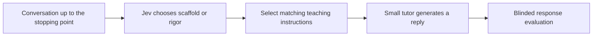

# TutorMoments: Choosing When to Help and When to Challenge

This project asks a practical question about AI math tutoring: **can a small decision model recognize when a student needs support and when they are ready for more independent thinking?** We use TutorMoments, which provides real math tutoring conversations stopped at teacher-identified decision points.

The next experiment asks whether a good decision improves the reply the student receives. See the [matched tutoring pilot](experiments/routing-pilot/PLAN.md) for the frozen design and [execution notes](experiments/routing-pilot/EXECUTION-NOTES.md) for infrastructure corrections. It compares a Jev-directed policy with a tutor that receives the same detailed policies and chooses for itself. Qwen3 14B and 32B provide a within-family model-size comparison.



The crucial test is whether this system beats **the same tutor with equally good instructions**, including routing delay and cost. Teacher-label routing is a diagnostic: it shows what happens when the intended category is known, but that label is unavailable in deployment. No student learning gains are measured.

There are three related experiments here:

1. **Matched Jev tutoring pilot:** first-reply quality, controlled prompts, both forced-policy outputs, routing errors, model size, cost and streaming latency. [Plan](experiments/routing-pilot/PLAN.md).

2. **Jev decision classification, completed:** give Jev the conversation available at the stopping point and ask it to choose `scaffolding` or `rigor`. Compare its choice with the dataset label. No tutor response is generated.
3. **OpenAI decision-router pilot, earlier work:** use a separate decision model to instruct a tutor LLM's next reply. This tests a different question. Its [runner and method guide](docs/openai-router-guide.md) remain available.

## Jev results

We tested **Jev 1.14.0** on all **520 moments**, evenly split between scaffolding and rigor. The first version used the publisher's evaluation-aware instructions with a short addition asking for a decision. We then compared four context-focused prompts on development cases and evaluated the selected version on the remaining students.

| Cases | Original prompt | Revised prompt |
|---|---:|---:|
| All 520 moments | 367 / 520, **70.6%** | 375 / 520, **72.1%** |
| Scaffolding moments | 200 / 260, 76.9% | 196 / 260, 75.4% |
| Rigor moments | 167 / 260, 64.2% | 179 / 260, 68.8% |
| Evaluation cases reserved for this round | 277 / 382, 72.5% | 280 / 382, 73.3% |

The revision recognized more rigor opportunities but lost a few scaffolding matches. It gained eight matches overall and three on the separate evaluation cases. The student-cluster bootstrap interval for the evaluation accuracy change was **−3.5 to +5.4 percentage points**. This is a small observed improvement, not evidence of better student learning.

## Start here

- [Jev experiment guide](experiments/jev/README.md): question, inputs, method, prompts and reproduction.
- [Original 520 decisions](experiments/jev/Jev%20decisions.csv): labels, choices, probabilities and timing.
- [Original versus revised decisions](experiments/jev/Context-focused%20prompt%20test/All%20520%20-%20Original%20versus%20optimized.csv): all paired results and development/evaluation membership.
- [Detailed prompt-comparison results](experiments/jev/Context-focused%20prompt%20test/Prompt%20test%20-%20Results.md): every candidate, examples, uncertainty, confidence, cost and timing.
- [Aggregate results](experiments/jev/Context-focused%20prompt%20test/Final%20comparison.json): machine-readable counts and confusion matrices.

## What is included

`experiments/jev/` contains the scripts, exact prompts, all four development candidates, frozen selection and split, request payloads and saved response JSON. There are 520 original responses, 552 development responses and 520 selected-prompt records. Of those selected-prompt records, 138 reuse development predictions. There were **1,454 unique successful classification requests**, rather than 1,592 new requests.

Unmodified experiment scripts are preserved under `experiments/jev/provenance/original_source/`. The runnable copies only adapt source-data locations to this repository. Predictions and result files retain their original bytes. A publication manifest records their hashes.

The repository remains private. API keys, console screenshots and billing/access records are excluded. The Jev request payloads contain excerpts from the public, de-identified TutorMoments corpus. The full upstream source is fetched separately. The older pipeline's local run directories are not part of this Jev update.

## Verify without an API key

Python 3.11 or newer. The Jev check uses only the standard library:

```sh
python3 tools/verify_jev_archive.py
```

This independently recomputes the headline counts, checks every paired CSV row and validates request hashes. It makes no network or model calls.

To check against the original source and student grouping:

```sh
python3 tools/fetch_jev_data.py
python3 "experiments/jev/Context-focused prompt test/verify_comparison.py"
```

The second command recomputes local verification summaries and the bootstrap interval. It makes no paid API calls. Source data defaults to `data/jev/`; set `TM_MOMENTS` and `TM_TRANSCRIPTS` to use existing copies. See the experiment guide before intentionally rerunning a paid experiment.

The earlier pipeline's offline tests remain:

```sh
PYTHONDONTWRITEBYTECODE=1 PYTHONPATH=src python3 -B -m unittest discover -s tests -v
```

Its source-parity test expects the original publisher ZIP at the workspace location recorded in the manifest. The Jev archive check does not require that ZIP.

## Sources and attribution

- Zhang et al. (2026), [When Help is Unhelpful: Evaluating AI Tutors for Productive Struggle](https://tutormoments.allen.ai/static/paper/tutormoments-preview.pdf). [Website](https://tutormoments.allen.ai/), [dataset](https://huggingface.co/datasets/allenai/tutormoments-preview), [code](https://github.com/allenai/tutormoments).
- TypeSafe: [Jev introduction](https://typesafe.ai/blog/introducing-system-one-models-and-jev), [quick start](https://docs.typesafe.ai/introduction/quickstart), [Choice primitive](https://docs.typesafe.ai/primitives/choice), [models](https://docs.typesafe.ai/models).

TutorMoments supplies the upstream prompts and conversation excerpts. Its Apache 2.0 license and notice remain under [third_party/tutormoments](third_party/tutormoments/). This is an independent course research project, not an official AllenAI or TypeSafe evaluation.
