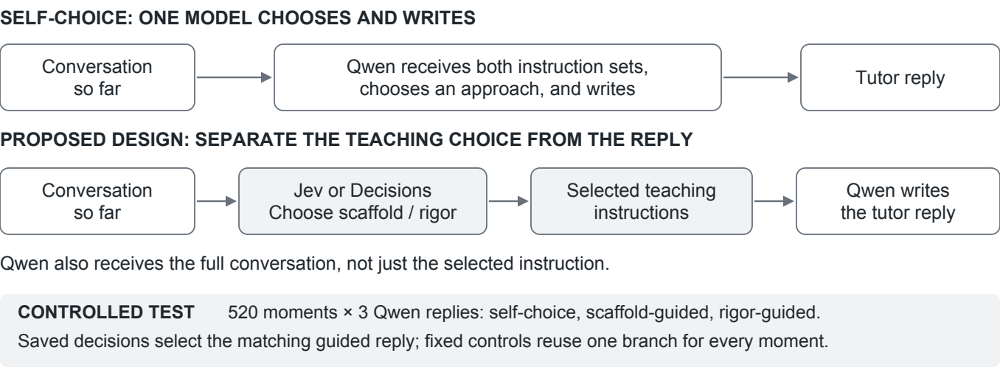

# Decision-Guided Mathematics Tutoring

Can a separate model help an AI tutor decide when to give a hint and when to ask the learner to reason more independently?

This EDUC 6181 course study uses TutorMoments-Preview, a public dataset of real tutoring conversations and AI continuations. It combines a qualitative study of the mathematical work left for learners with an experiment testing decision-guided tutoring. The experiment is complete. Its main finding is that separate decisions improved the overall score over a tutor choosing its own approach, but did not beat a simple fixed rigor instruction.

## Paper and study materials

- [Final paper, four pages plus references](paper/course-draft/Conference%20Paper%20Draft.pdf) and [LaTeX source](paper/course-draft/main.tex).
- [Qualitative analysis folder](https://drive.google.com/drive/folders/1PRhd04y0frYdvlDwIcqd27XcJX7hLSpD): three-tab workbook, coding manual, readable casebook, and complete records.
- [Technical analysis folder](https://drive.google.com/drive/folders/1Oqy731wJQkNdRJABpMrL6EE4DM9BPZ5B): methods and results, all 520 case results, and the complete reproducibility package.
- [Project literature in Zotero](https://www.zotero.org/groups/6740618).

The Drive copies are viewable by anyone with the link, so a reviewer does not need access to this private repository. This is a course draft, not a conference submission.

## What we tested

The proposed system has two stages:

1. A decision model reads the conversation and chooses **scaffolding** (make the next step accessible) or **rigor** (invite explanation, justification, or independent work).
2. That choice selects detailed instructions for **Qwen3-32B**, which writes the tutor's reply using the same conversation.

A decision model selects from predefined actions instead of writing the student-facing reply. TypeSafe introduced Jev for fast structured choices ([original announcement](https://typesafe.ai/blog/introducing-system-one-models-and-jev)); OpenAI Decisions is a software interface for requesting choices from a model ([documentation](https://developers.openai.com/api/docs/guides/decisions)).



We tested **Jev 1.14.0** and **OpenAI Decisions using GPT-6 Luna** as decision systems. We first measured whether their choices matched the dataset's assigned category, then separately evaluated the replies those choices selected. We did not fine-tune any model.

## How the response experiment worked

We used all 520 evaluation moments, 260 per assigned category. At every moment, Qwen generated three replies: one where it chose between the two detailed instruction sets itself, one with scaffold instructions, and one with rigor instructions. This produced **1,560 replies**.

The decisions had been recorded in earlier experiments. We reused them to select the matching scaffold or rigor reply. This lets both decision systems and the fixed-instruction controls use exactly the same candidate text. It is a controlled comparison of response selection, not a timed deployment of a live sequential pipeline.

All models received the complete preceding conversation. Neither decision system received the assigned category, teacher explanation, or future turns. Qwen's original prompt also included a tutoring-platform identifier, the same value in all 520 cases. Gemini 2.5 Flash evaluated the replies anonymously; Claude Sonnet 4.6 repeated the evaluation on 32 cases.

## Results

Decision-category agreement was **376/520 (72.3%) for Jev** and **386/520 (74.2%) for Decisions**. These figures are different from the response-quality results below.

| How the tutor's instruction was chosen | Passing replies /520 | Rate | Mathematics comparison /346 |
|---|---:|---:|---:|
| Qwen chose its own approach | 357 | 68.7% | 249 (72.0%) |
| Jev chose | 379 | 72.9% | 252 (72.8%) |
| OpenAI Decisions chose | 382 | 73.5% | 260 (75.1%) |
| Always scaffold | 294 | 56.5% | 207 (59.8%) |
| Always rigor | 385 | 74.0% | 263 (76.0%) |
| Use the dataset label, diagnostic only | 438 | 84.2% | 299 (86.4%) |
| Use the opposite label, diagnostic only | 241 | 46.3% | 171 (49.4%) |

**Neither decision system beat fixed rigor guidance.** Jev's gain over self-choice was 4.2 percentage points overall (95% student-cluster interval -1.0 to 9.2), but only 0.9 points in the stricter mathematics comparison (-5.3 to 6.5). That subset also requires suitable conversation boundaries and usable original responses; it is not a subject-only filter.

The evaluators also disagreed. On the same 32 cases, Gemini passed 20 self-choice and 19 Jev replies, whereas Claude passed 16 and 22. Matching the category was not sufficient: 56 of Jev's 376 category matches still led to failed replies. A concrete example selected scaffolding correctly but answered an earlier problem instead of the current one.

These are automated ratings of the first reply, not the publisher's multi-turn leaderboard score or student learning outcomes. The dataset had been used during prompt development. All prior runs, including worse prompt revisions, remain available in the [experiment history](EXPERIMENT_HISTORY.md). No latency advantage was demonstrated. New spending for the completed response experiment and evaluations was **$3.0029**.

## Qualitative study

We coded **114 response blocks from 38 mathematics moments**, comparing human continuations with GPT-5.5 under general and explicit pedagogical instructions. The codebook distinguishes **work left for the learner** from **information already supplied by the tutor**. In the reported AI-assisted coding pass, explicit instructions left a connection, explanation, or strategy in 16/38 replies, versus 2/38 general-instruction replies. The paper illustrates the code distinctions with three source-verified cases: missing-factor calculation (E01), explaining a fraction denominator (E06), and explaining an incorrect percentage after the answer is supplied (E11). Both coding passes and their disagreements are preserved.

See the [workbook](paper/qualitative-study/Qualitative%20Coding%20and%20Results.xlsx), [coding manual](paper/qualitative-study/Qualitative%20Coding%20Manual.pdf), and [casebook](paper/qualitative-study/Qualitative%20Cases%20and%20Coding.pdf). The human continuations are a naturalistic reference. Higher work-left codes are not automatically better teaching, and no independent human coding validation is claimed.

## Inspect and reproduce

- [Technical methods and all results](experiments/final-course-pipeline/Technical%20Methods%20and%20Results.pdf).
- [All actual replies and ratings](experiments/final-course-pipeline/replies-and-ratings.csv), [all 520 paired comparisons](experiments/final-course-pipeline/case-results.csv), and [evaluator audit](experiments/final-course-pipeline/Evidence%20and%20Evaluator%20Audit.md).
- [Frozen design and implementation guide](experiments/final-course-pipeline/README.md), including exact prompts, raw traces, and verification commands.

For a standalone reproduction without credentials or API calls, download **Technical Experiment - Complete Review Package.zip** from the technical Drive folder. Unzip it, enter the extracted `Technical Experiment` directory, and run:

```bash
python3 reproduce_summary.py
```

The bundle includes all original contexts and saved predictions needed to recompute results. The original source data are [TutorMoments-Preview](https://huggingface.co/datasets/allenai/tutormoments-preview), licensed CC BY 4.0; publisher attribution and source identifiers are retained. The qualitative and technical analyses use different samples and measures, connected by the question of how to preserve useful mathematical work for learners.
